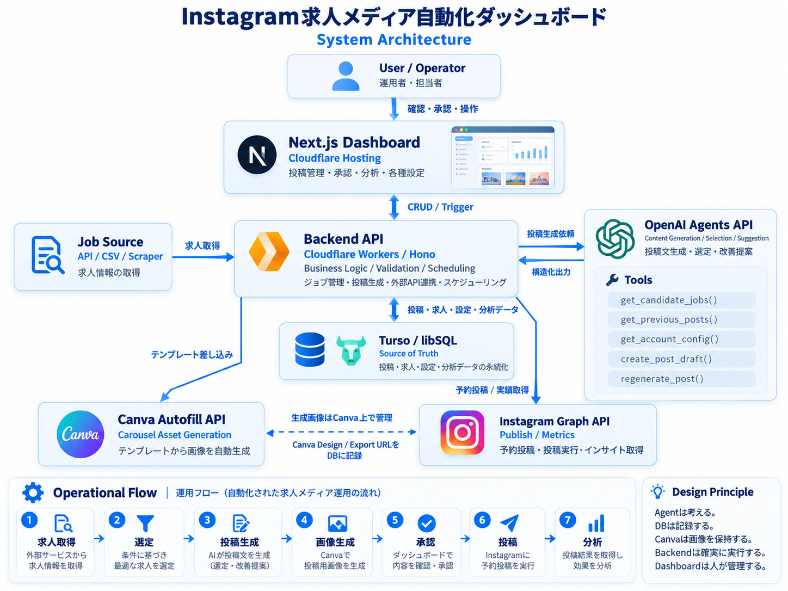

## Overview



求人データの取得から、投稿生成、画像生成、承認、Instagram 投稿、分析までを一元管理する。

構成上は以下の役割に分ける。

- **Dashboard**：人が確認・承認・操作する
- **Backend**：Business Logic・Validation・Scheduling を実行する
- **Database**：正式なデータを保持する
- **OpenAI Agent**：投稿生成・選定・改善提案を行う
- **Canva**：投稿画像を生成・保持する
- **Instagram API**：投稿・インサイト取得を行う

---

# Main Components

## 1. Next.js Dashboard

**Hosting：Cloudflare**

主な役割：

- 投稿候補一覧
- 投稿プレビュー
- 修正・承認・却下
- 投稿スケジュール管理
- アカウント設定
- 投稿実績・分析の確認

Dashboard は Control Plane として利用し、直接 AI 処理や投稿処理を持たせない。

---

## 2. Backend API

**Cloudflare Workers / Hono**

主な役割：

- Job 管理
- 投稿生成の Trigger
- Business Logic
- Validation
- Scheduling
- Canva / Instagram / OpenAI との API 連携

承認・予約投稿・ステータス変更など、確実に実行する必要がある処理は Backend 側で管理する。

---

## 3. Database

**Turso / libSQL**

System 全体の **Source of Truth** として利用する。

主なデータ：

- `accounts`
  - Instagram アカウント設定
  - 投稿条件
  - テンプレート
  - 投稿頻度
- `jobs`
  - 求人データ
  - 会社名
  - 職種
  - 給与
  - 勤務地
  - 求人 URL
- `posts`
  - 投稿案
  - Caption
  - Status
  - Scheduled At
  - Instagram Post ID
- `post_assets`
  - Canva Design ID
  - Canva Export URL
  - 使用テンプレート
- `metrics`
  - Reach
  - Like
  - Save
  - Share
  - Follow
- `agent_sessions`
  - OpenAI Agent Session ID

---

## 4. OpenAI Agents API

投稿生成・選定・改善提案など、知的処理を担当する。

主な Tools（Backend 定義・Agent はこれ経由のみ）：

**Ideation（実装済み / OpenAI Agents SDK）**

- `get_guideline()` — 人間が Dashboard で編集したガイドライン
- `list_references()` — 人間がアップロードした参照（構造・フック等）
- `get_memory()` — 重複防止・却下学習
- `get_previous_posts()`
- `check_duplicate()`
- `get_candidate_jobs()` — 任意（求人なしでも企画可能）

**Creation（Phase 3 で Agents 化）**

- `create_post_draft()` / `submit_deck()`
- `regenerate_post()`

Agent から DB を直接自由に操作させるのではなく、Backend 側で定義した限定的な Tool を経由して処理する。書き込み（ideas / posts / memory）は API が確定する。

Agent の主な役割：

- 投稿候補の企画（Ideation）
- Carousel 構成生成・Caption 生成（Creation）
- 過去投稿・メモリーを踏まえた改善提案

---

## 5. Renderer + Canva (PPTX import / PNG export)

> v1.2 で Canva Autofill（ブランドテンプレート方式）から変更。詳細は末尾の「v1.2 Addendum」。

投稿のデザインは `packages/renderer`（自前）が決める。アカウントの **DesignSpec**（色・文字・レイアウト）と投稿ごとの文面から PPTX を生成し、Canva に **import**、PNG を **export** する。Canva は「編集できる成果物」と「プレビュー画像」の置き場所で、テンプレートは使わない。

DB には以下の参照情報を保存する。

- Canva Design ID
- Export URL（ページごと）
- Post ID

アカウント画像（アップロード素材・AI イラスト）は Cloudflare R2（`IMAGE_ASSETS`）に置く。参照ファイルは `REFERENCE_FILES`。

---

## 6. Instagram Graph API

主な役割：

- 承認済み投稿の予約投稿
- 投稿実行
- Instagram Post ID 取得
- 投稿実績・Insight 取得

取得した実績は Turso に保存し、Dashboard の分析画面に反映する。

---

# System Flow

```
Job Source
API / CSV / Scraper
        ↓
Backend API
Cloudflare Workers / Hono
        ↓
Turso / libSQL
        ↓
OpenAI Agents API
        ↓
投稿案生成
        ↓
Renderer (DesignSpec → PPTX) → Canva import / export
        ↓
Carousel画像生成
        ↓
Dashboardで確認・承認
        ↓
Instagram Graph API
        ↓
投稿
        ↓
Metrics取得
        ↓
Tursoへ保存
        ↓
Dashboardで分析
```

---

# Operational Flow

1. **求人取得**

   外部サービスから求人情報を取得する。

2. **選定**

   アカウント設定や条件に基づいて投稿対象を選定する。

3. **投稿生成**

   OpenAI Agent が Caption・Carousel 構成を生成する。

4. **画像生成**

   アカウントのデザインから PPTX を生成して Canva に取り込み、PNG を書き出す。

5. **承認**

   Dashboard で人が内容を確認・修正・承認する。

6. **投稿**

   承認済み投稿を Instagram へ予約・投稿する。

7. **分析**

   投稿実績を取得し、次回の投稿改善に利用する。

---

# v1.1 Addendum: AI Ideation (first build scope)

First implementation scope prioritizes **AI content ideation + carousel creation (3-10 pages, default 8)**, ending at **approve → schedule**. Instagram publish and metrics remain as in v1 but are not built yet.

## Changes relative to the job-centric flow above

| v1 step | v1.1 first scope |
|---|---|
| 1. 求人取得 | Optional later. Not required to ideate. |
| 2. 選定 | **AI ideation** from human **guideline** + **reference** + system **memory** |
| 3–5 | Unchanged in spirit: agent draft → Canva → human approve |
| 6–7 | Deferred (store `scheduled` / `scheduled_at` only) |

## Human-owned inputs (Dashboard)

- **Guideline** — target, concept, tone, pillars, NG rules, CTA/hashtag policy, system prompt (uploaded/edited by humans)
- **Reference** — slide/hook/voice patterns and docs (uploaded/managed by humans; inspired-by structure only)

## System memory

Written by Backend on approve/reject (and later edits). Used by the ideation agent to avoid duplicates.

## Agent tools (ideation-first)

- `get_guideline`, `list_references`, `get_memory`, `get_previous_posts`, `check_duplicate`, optional `get_candidate_jobs`, `submit_ideas`
- Creation: `get_idea`, `submit_deck`, plus guideline/reference (and optional job)

## New / extended data (see `packages/db/sql/schema.sql`)

- `guidelines`, `references`, `memory_items`, `ideas`
- `posts`: `idea_id`, `slides_json`, `scheduled_at`, generation fields
- `post_assets`: `slide_index`, Canva design id, export URL

Detail: `docs/features/content-ideation.md`, `docs/features/content-creation.md`, `docs/phase-0-feasibility.md`.

---

# v1.2 Addendum: Design, structure and onboarding

Replaces the Canva-template approach. Every post used to look the same because the layout lived in one Canva template; now the look is derived per account and varied per post.

## Flow

1. **Account design** — the owner adds reference Instagram screenshots (a link is only a note, never fetched) and/or a written guideline; the AI derives a `DesignSpec` (theme, type, layout) and stores it in `accounts.design_json`.
2. **Per-post variation** — `varySpec(spec, seed)` changes accents/decor/underline deterministically per post (`none` | `subtle` | `lively`); contrast is guarded (`ensureReadable`).
3. **Render** — `@ama/renderer` lays each page out as a flat list of elements, consumed by an HTML preview and by `pptxgenjs` (PPTX, 1080×1350 px).
4. **Canva** — PPTX → `POST /v1/imports` → editable design; `POST /v1/exports` → PNG per page. Manual edits in Canva are possible; "プレビューを更新" re-exports them.
5. **Regenerate** — a user who dislikes a post's look types a prompt in the editor; the AI patches that post's spec (`POST /posts/:id/design/regenerate`).

## Slide structure

Account-level list of page roles (`cover`, `empathy`, `point`, `pick`, `cta`), 3-10 pages, inferred from reference screenshots or edited by hand. The creation agent's schema, validation, renderer and editor all derive from it; a post keeps the structure it was created with.

## Onboarding

Adding an account is a 6-step wizard (account → target/concept → design → slide structure → schedule → done). Everything entered is stored on the account and editable later in the **agent settings** and **design** tabs.

## Storage and cost

- `accounts.design_json` = `{spec, guideline, referenceNote, summary, structure, structureSummary, analysisCostUsd, updatedAt}`
- `posts.slides_json` also carries `structure`, `images`, `design`, `designPrompt`, `costUsd {copy, images, design}`
- Costs come from token usage × rate table (`openai-cost.ts`); rendering and Canva are free.

Detail: `docs/features/design.md`, `docs/features/onboarding.md`, `docs/features/content-creation.md`.
